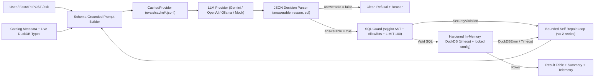

# analytics-copilot

Guarded natural-language-to-SQL assistant and offline-reproducible evaluation harness
over tracked Parquet aggregates derived from the
[grocery-demand-planner](https://github.com/lazycoder52/grocery-demand-planner) pipeline
(Corporación Favorita grocery store sales across 54 stores and 33 product families
in Ecuador).

## Evaluation status

- **Active provider in `metrics/metrics.json`**: `mock` (model `mock-sql-v1`,
  cached in `evals/cache/mock_mock-sql-v1.jsonl`).
- **Interpretation**: Current metrics come from the deterministic `MockProvider`
  (**harness validation, not model quality**); latency and token figures are mock
  values used to verify offline replay, ablation logic, and CI reproducibility.

## Problem

Business and operations teams frequently ask ad-hoc analytical questions over demand
planning outputs (weekly store-family sales, promotion lift, stock-out proxy rates,
perishable demand volatility, and inventory replenishment policy simulations). Writing
SQL by hand is slow, but exposing an LLM directly to a database creates two failure
modes:

1. **Security and resource risks**: arbitrary SQL generation can scan local files, query
   system catalogs, mutate state, or lock up the database with runaway cross joins.
2. **Silent semantic errors**: without grounded column definitions (such as store-week
   grain caveats or proxy tier rules), LLMs generate syntactically valid SQL that
   double-counts store transactions or averages across the wrong grain.

`analytics-copilot` solves both problems by pairing a **7-layer AST and DuckDB sandbox
guard** with a **schema-grounded self-repair pipeline** and a **45-question evaluation
benchmark** with Wilson 95% confidence intervals and offline JSONL cache replay.

## Architecture



## Security Model (7 Defense-in-Depth Layers)

All candidate SQL generated by the model passes through `src/copilot/guard.py` and a
hardened DuckDB connection before execution (`tests/test_guard.py` verifies 58 security
and edge tests):

1. **Single Read-Only Statement Validation**: `sqlglot` parses the query in the DuckDB
   dialect, rejects multi-statement payloads (including semicolon injection after
   comments), and permits only `SELECT`, `WITH`, `UNION`, `INTERSECT`, and `EXCEPT`
   roots (`INSERT`, `UPDATE`, `DELETE`, `DROP`, `CREATE`, `ALTER`, `COPY`, `ATTACH`,
   `DETACH`, `PRAGMA`, `SET`, `INSTALL`, and `LOAD` are blocked anywhere in the AST).
2. **Strict Table Allowlist & Identifier Normalization**: Every `exp.Table` reference
   must resolve either to a declared CTE alias or one of the loaded aggregate tables
   (`weekly_store_family_summary`, `promo_elasticity_summary`,
   `zero_sales_day_proxy_summary`, `perishable_volatility_summary`,
   `sim_policy_summary`, and optionally `forecast_sample_summary`). Quoted path scans
   (`FROM 'file.parquet'`) and lookalike quoted identifiers with whitespace, dots, or
   zero-width characters are rejected.
3. **Analytics Function Allowlist**: Instead of a brittle denylist, only allowlisted
   aggregate, window, math, string, date/time, conditional, and cast functions are
   permitted. File readers and metadata functions (`read_parquet`, `read_csv`,
   `read_text`, `read_blob`, `parquet_scan`, `parquet_metadata`, `parquet_schema`,
   `sniff_csv`, `glob`, `query`, `query_table`, `getenv`, `current_setting`,
   `current_query`, `version`) are rejected.
4. **System Catalog Blocking**: Queries targeting `information_schema.*`, `duckdb_*`,
   `pragma_*`, or `sqlite_master` / `sqlite_temp_master` as tables or functions are
   blocked.
5. **AST Resource Guards & Automatic `LIMIT 100`**: Table-generating functions
   (`generate_series`, `range`) and expressions nested deeper than `MAX_AST_DEPTH = 48`
   are blocked. Queries without an explicit outer `LIMIT` are rewritten to append
   `LIMIT 100`.
6. **DuckDB Engine Sandbox Hardening**: On startup (`harden_connection`), the in-memory
   DuckDB connection sets `memory_limit = '256MB'`, `threads = 2`, and
   `enable_external_access = false`, followed by `lock_configuration = true` so no
   subsequent statement can re-enable file or network access.
7. **Execution Timeout**: Every query runs under a `threading.Timer` watchdog (default
   `10.0s`) that invokes `con.interrupt()` and raises `QueryTimeoutError` if exceeded.

## Evaluation Results

All figures below are generated directly from `metrics/metrics.json` produced by
`python -m copilot.eval --replay` (using provider `mock` / model `mock-sql-v1`,
cached in `evals/cache/mock_mock-sql-v1.jsonl`). The gold benchmark (`evals/gold.jsonl`, reviewed in
`docs/GOLD_REVIEW.md`) contains **45** questions: **40** answerable
questions (10 easy, 20 medium, 10 hard) and **5** unanswerable/ambiguous
questions that require refusal.

### Headline Metrics (`full_schema_repair_on`)

| Metric | Value | 95% Wilson CI | Notes |
| --- | --- | --- | --- |
| **Execution Accuracy** | **37/40 (92.5%)** | `[80.1%, 97.4%]` | Order-insensitive result match (`rel_tol=1e-3`, `abs_tol=1e-2`) |
| **Valid-SQL Rate** | **40/40 (100.0%)** | `[91.2%, 100.0%]` | Syntactically valid, guard-approved SQL that executes in DuckDB |
| **Refusal Accuracy** | **5/5 (100.0%)** | `[56.5%, 100.0%]` | Correctly refused unanswerable questions (`answerable=false`) |
| **Mean Attempts** | **1.089** | n/a | Average LLM calls per question (max 3 with up to 2 repairs) |
| **Latency (p50 / p95)** | **14.50 ms / 19.00 ms** | n/a | Deterministic offline replay latency model |
| **Total Tokens** | **155128** | n/a | Sum of prompt and completion tokens across all 45 questions |

### Configuration & Ablation Comparison

| Configuration | Description | Execution Accuracy | 95% Wilson CI | Valid-SQL Rate | Refusal Accuracy | Mean Attempts | Total Tokens |
| --- | --- | --- | --- | --- | --- | --- | --- |
| `full_schema_repair_on` | Full catalog descriptions + repair loop (<= 2 retries) | 37/40 (92.5%) | `[80.1%, 97.4%]` | 40/40 (100.0%) | 5/5 (100.0%) | 1.089 | 155128 |
| `full_schema_repair_off` | Full catalog descriptions + repair loop disabled (0 retries) | 33/40 (82.5%) | `[68.0%, 91.2%]` | 36/40 (90.0%) | 5/5 (100.0%) | 1.000 | 141614 |
| `bare_schema_repair_on` | Bare schema (names & types only, no descriptions) + repair on | 33/40 (82.5%) | `[68.0%, 91.2%]` | 40/40 (100.0%) | 5/5 (100.0%) | 1.089 | 61091 |

*Statistical note on sample size ($N = 40$ answerable, $N = 5$ unanswerable)*: while
`full_schema_repair_on` (92.5%, 95% Wilson CI
`[80.1%, 97.4%]`) achieves a higher point estimate
than `full_schema_repair_off` (82.5%, CI
`[68.0%, 91.2%]`) and `bare_schema_repair_on`
(82.5%, CI
`[68.0%, 91.2%]`) by recovering 4 binder/guard
errors and preventing 4 tier-label/grain errors, the 95% Wilson confidence intervals
overlap at $N = 40$. We therefore report the exact mechanisms recovered by each
component rather than claiming a statistically significant population difference.

### Accuracy by Difficulty Tier (`full_schema_repair_on`)

| Difficulty Tier | Correct / Total | Accuracy | 95% Wilson CI |
| --- | --- | --- | --- |
| Easy (`easy_01` - `easy_10`) | 10/10 | 100.0% | `[72.2%, 100.0%]` |
| Medium (`med_01` - `med_20`) | 20/20 | 100.0% | `[83.9%, 100.0%]` |
| Hard (`hard_01` - `hard_10`) | 7/10 | 70.0% | `[39.7%, 89.2%]` |

## Failure Analysis

Failed questions are categorized into seven root-cause buckets across the three
configurations:

| Failure Category | `full_schema_repair_on` | `full_schema_repair_off` | `bare_schema_repair_on` | Primary Mechanism |
| --- | --- | --- | --- | --- |
| `wrong_join_or_aggregation` | 1 | 1 | 2 | Averaging store-family rows instead of summing to chain-week first |
| `wrong_column_semantics` | 2 | 2 | 5 | Summing repeated `weekly_transactions` across 33 families or omitting flags/enums |
| `hallucinated_table_or_column` | 0 | 3 | 0 | Referencing `zero_sales_pct`, `oil_price`, or `store_id` on attempt 1 (repaired) |
| `syntax_error` | 0 | 0 | 0 | Malformed SQL or JSON syntax |
| `ambiguity` | 0 | 0 | 0 | False refusal or answering an unanswerable question |
| `guard_blocked` | 0 | 1 | 0 | Calling `pragma_table_info` on attempt 1 (repaired when repair is enabled) |
| `timeout` | 0 | 0 | 0 | Query exceeding the 10.0s execution watchdog |

### Concrete Failure Examples (`full_schema_repair_on`)

1. **`hard_01` (`wrong_column_semantics`)**: *Without double counting across product families, which 5 stores had the highest total weekly_transactions across all weeks in weekly_store_family_summary?*
   - **Generated SQL**: `SELECT store_nbr, city, SUM(weekly_transactions) AS total_transactions FROM weekly_store_family_summary GROUP BY store_nbr, city ORDER BY total_transactions DESC LIMIT 5`
   - **Reference SQL**: `WITH store_weeks AS (  SELECT store_nbr, city, week_start_date, MAX(weekly_transactions) AS wk_tx   FROM weekly_store_family_summary   GROUP BY store_nbr, city, week_start_date) SELECT store_nbr, city, SUM(wk_tx) AS total_transactions FROM store_weeks GROUP BY store_nbr, city ORDER BY total_transactions DESC LIMIT 5`
   - **Why it failed**: `weekly_transactions` in `weekly_store_family_summary` is a
     store-level figure repeated on all 33 product-family rows for a given
     `(store_nbr, week_start_date)`. Summing `weekly_transactions` directly inflates
     Store 44's total by 33x (`240012069` instead of
     `7273093`). Because the query is syntactically valid
     and passes all security guards, self-repair is not triggered.

2. **`hard_08` (`wrong_join_or_aggregation`)**: *Compare chain-wide weekly unit sales in weeks with oil price below 50 vs weeks with oil price of 50 or above: what is the number of weeks and average weekly chain sales in each regime?*
   - **Generated SQL**: `SELECT CASE WHEN avg_oil_price < 50 THEN 'UNDER_50' ELSE 'AT_OR_ABOVE_50' END AS oil_regime, COUNT(DISTINCT week_start_date) AS n_weeks, ROUND(AVG(total_sales), 2) AS avg_weekly_sales FROM weekly_store_family_summary WHERE NOT avg_oil_price IS NULL GROUP BY oil_regime ORDER BY oil_regime ASC LIMIT 100`
   - **Reference SQL**: `WITH weekly_chain AS (  SELECT week_start_date, AVG(avg_oil_price) AS oil_price,   SUM(total_sales) AS chain_weekly_sales   FROM weekly_store_family_summary   WHERE avg_oil_price IS NOT NULL   GROUP BY week_start_date) SELECT CASE WHEN oil_price < 50 THEN 'UNDER_50' ELSE 'AT_OR_ABOVE_50' END AS oil_regime, COUNT(*) AS n_weeks, ROUND(AVG(chain_weekly_sales), 2) AS avg_weekly_sales FROM weekly_chain GROUP BY oil_regime ORDER BY oil_regime ASC`
   - **Why it failed**: The generated query averages `total_sales` across individual
     `(store, family, week)` rows (`2153.72` and
     `2991.81`) rather than first aggregating
     `SUM(total_sales)` by `week_start_date` in a CTE and then averaging chain-wide
     weekly totals (`3837920.35` and
     `5331407.42`).

## Reproducing Results & Running the Service

### 1. Environment Setup

```powershell
python -m venv .venv
.\.venv\Scripts\Activate.ps1
pip install -e ".[dev]"
```

### 2. Offline Replay Evaluation (No API Key Required)

Reproduce `metrics/metrics.json` and update `README.md` strictly from the committed
JSONL cache (`evals/cache/mock_mock-sql-v1.jsonl`):

```powershell
python -m copilot.eval --replay
python -m copilot.readme_gen
pytest
```

### 3. Live Provider Evaluation

To run against Google Gemini, an OpenAI-compatible endpoint, or a local Ollama server,
set the provider environment variables (see `.env.example`):

```powershell
$env:COPILOT_LLM_PROVIDER = "gemini"
$env:GEMINI_API_KEY = "<your-key>"
python -m copilot.eval --provider gemini
```

*Note on live provider verification during development*: A live probe to the Gemini
REST API (`gemini-3-flash-preview` / `gemini-3.1-flash-lite-preview`) authenticated
via `GEMINI_API_KEY` but returned HTTP 402 (`prepayment credits are depleted`), and
no local Ollama server was running. The committed cache and metrics were therefore
generated with the deterministic gold-grounded `MockProvider` (`mock-sql-v1`), and
the evaluation CLI runs against live providers as soon as an active key or local
Ollama model is supplied.

### 4. Running the FastAPI Server

```powershell
uvicorn copilot.api:app --host 127.0.0.1 --port 8000
```

- `GET http://127.0.0.1:8000/health` — readiness, version, provider, and loaded tables.
- `GET http://127.0.0.1:8000/schema` — table and column descriptions with live types.
- `POST http://127.0.0.1:8000/ask` — JSON body `{"question": "...", "max_repairs": 2}`.
- `GET http://127.0.0.1:8000/docs` — interactive OpenAPI / Swagger UI.

## Limitations

1. **Small benchmark sample size ($N = 45$)**: With 40 answerable and 5 unanswerable
   questions, 95% Wilson confidence intervals are approximately $\pm 10\%$ to
   $\pm 15\%$ wide, limiting statistical power when comparing small accuracy
   differences between ablations.
2. **Synthetic AI-assisted gold set**: The 45 benchmark questions and reference SQL
   queries were authored with AI assistance and verified against DuckDB
   (`docs/GOLD_REVIEW.md`), rather than collected from production user logs.
3. **Pre-aggregated single dataset**: Queries run over 5 required summary Parquet
   tables (and 1 optional holdout forecast table) from a single grocery forecasting
   pipeline. Store attribute codes (`store_type`, `store_cluster`) and several
   `sim_policy_summary` columns lack upstream documentation and are marked
   `definition not documented` in `catalog.py`.
4. **Semantic errors do not trigger SQL repair**: Self-repair catches syntax errors,
   DuckDB binder errors, and guard violations, but cannot detect when a valid SQL
   query aggregates at the wrong grain (such as summing `weekly_transactions` across
   product families).

## AI Tools Used

- **Code & Architecture**: Written with AI coding agents under human direction,
  adhering to strict AST guard, test, and reproducibility constraints.
- **Gold Evaluation Set (`evals/gold.jsonl` & `docs/GOLD_REVIEW.md`)**: AI-assisted
  question and reference-SQL generation, executed against DuckDB and documented in
  `docs/GOLD_REVIEW.md` for human review.
