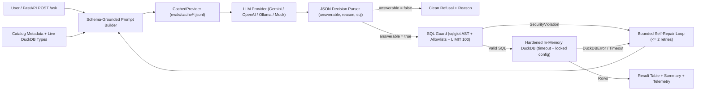

# analytics-copilot

Guarded natural-language-to-SQL assistant and offline-reproducible evaluation harness
over tracked Parquet aggregates derived from the
[grocery-demand-planner](https://github.com/lazycoder52/grocery-demand-planner) pipeline
(Corporación Favorita grocery store sales across 54 stores and 33 product families
in Ecuador).

## Evaluation status

- **Primary provider in `metrics/metrics.json` (Run A)**: `openai_compatible` (requested model `openai/gpt-oss-120b`, API-returned model `openai/gpt-oss-120b`, endpoint host `api.groq.com`, `temperature=0.0`, `run_date=2026-10-26`, cached in `evals/cache/openai_compatible_openai_gpt-oss-120b.jsonl`).
- **Completion & infrastructure status**: **45/45** questions completed (**0** unresolved; **0** infrastructure failures excluded from accuracy denominators).
- **Interpretation**: Primary headline and ablation metrics come from recorded
  live LLM calls against `api.groq.com` (`openai/gpt-oss-120b`) replayed
  deterministically from `evals/cache/openai_compatible_openai_gpt-oss-120b.jsonl`.
- **Secondary live provider (Run B — `api.groq.com`)**: `openai_compatible` (requested model `openai/gpt-oss-20b`, API-returned model `openai/gpt-oss-20b`, `temperature=0.0`, `run_date=2026-10-26`, cached in `evals/cache/openai_compatible_openai_gpt-oss-20b.jsonl`) — **45/45** completed on `full_schema_repair_on`, execution accuracy **30/40 (75.0%)** on `full_schema_repair_on`; `bare_schema_repair_on` is incomplete, Groq daily token cap (42/45 completed).
- **Harness validation baseline (`MockProvider` / `mock-sql-v1`)**: **harness validation only, not model quality** (latency and token counts are synthetic mock values; cached in `evals/cache/mock_mock-sql-v1.jsonl`, 37/40 = 92.5% on `full_schema_repair_on`). All `mock-sql-v1` grain ablation and held-out figures in `metrics/metrics.json` are **harness validation only, not evidence that the grain fixes work**.
- **Grain ablation summary**: The grain fixes did not change live results on gold (sanity check 70.0% vs 70.0%, while `catalog_grain_notes_repair_on` 0/45 and `grain_aware_prompt_repair_on` 0/45 are incomplete, Groq daily token cap); the held-out set was already 100% before any change (`full_schema_repair_on` 10/10 = 100.0%, `catalog_grain_notes_repair_on` 10/10 = 100.0%, `grain_sanity_check_repair_on` 10/10 = 100.0%, while `grain_aware_prompt_repair_on` 0/10 is incomplete, Groq daily token cap), so it cannot show improvement; **no improvement is claimed**.
- **Gateway & rate-limit note**: Anonymous free gateways (`text.pollinations.ai/openai` and `api.llm7.io/v1` with alias `openai-fast`) were probed; `api.llm7.io` returned `HTTP 400 model_unavailable` and `text.pollinations.ai` enforced a 1 req/30s IP cap (attempted and abandoned after 31/45 questions in favor of `openai/gpt-oss-20b` on `api.groq.com`). Gateway aliases like `openai-fast` may change upstream routing over time.

## Problem

Business and operations teams frequently ask ad-hoc analytical questions over demand
planning outputs (weekly store-family sales, promotion lift, stock-out proxy rates,
perishable demand volatility, and inventory replenishment policy simulations). Writing
SQL by hand is slow, but exposing an LLM directly to a database creates two failure
modes:

1. **Security and resource risks**: arbitrary SQL generation can scan local files, query
   system catalogs, mutate state, or lock up the database with runaway cross joins.
2. **Silent semantic errors**: without grounded column definitions (such as store-week
   grain caveats or proxy tier rules), LLMs generate syntactically valid SQL that
   double-counts store transactions or averages across the wrong grain.

`analytics-copilot` solves both problems by pairing a **7-layer AST and DuckDB sandbox
guard** with a **schema-grounded self-repair pipeline** and a **45-question evaluation
benchmark** with Wilson 95% confidence intervals and offline JSONL cache replay.

## Architecture



## Security Model (7 Defense-in-Depth Layers)

All candidate SQL generated by the model passes through `src/copilot/guard.py` and a
hardened DuckDB connection before execution (`tests/test_guard.py` verifies 58 security
and edge tests):

1. **Single Read-Only Statement Validation**: `sqlglot` parses the query in the DuckDB
   dialect, rejects multi-statement payloads (including semicolon injection after
   comments), and permits only `SELECT`, `WITH`, `UNION`, `INTERSECT`, and `EXCEPT`
   roots (`INSERT`, `UPDATE`, `DELETE`, `DROP`, `CREATE`, `ALTER`, `COPY`, `ATTACH`,
   `DETACH`, `PRAGMA`, `SET`, `INSTALL`, and `LOAD` are blocked anywhere in the AST).
2. **Strict Table Allowlist & Identifier Normalization**: Every `exp.Table` reference
   must resolve either to a declared CTE alias or one of the loaded aggregate tables
   (`weekly_store_family_summary`, `promo_elasticity_summary`,
   `zero_sales_day_proxy_summary`, `perishable_volatility_summary`,
   `sim_policy_summary`, and optionally `forecast_sample_summary`). Quoted path scans
   (`FROM 'file.parquet'`) and lookalike quoted identifiers with whitespace, dots, or
   zero-width characters are rejected.
3. **Analytics Function Allowlist**: Instead of a brittle denylist, only allowlisted
   aggregate, window, math, string, date/time, conditional, and cast functions are
   permitted. File readers and metadata functions (`read_parquet`, `read_csv`,
   `read_text`, `read_blob`, `parquet_scan`, `parquet_metadata`, `parquet_schema`,
   `sniff_csv`, `glob`, `query`, `query_table`, `getenv`, `current_setting`,
   `current_query`, `version`) are rejected.
4. **System Catalog Blocking**: Queries targeting `information_schema.*`, `duckdb_*`,
   `pragma_*`, or `sqlite_master` / `sqlite_temp_master` as tables or functions are
   blocked.
5. **AST Resource Guards & Automatic `LIMIT 100`**: Table-generating functions
   (`generate_series`, `range`) and expressions nested deeper than `MAX_AST_DEPTH = 48`
   are blocked. Queries without an explicit outer `LIMIT` are rewritten to append
   `LIMIT 100`.
6. **DuckDB Engine Sandbox Hardening**: On startup (`harden_connection`), the in-memory
   DuckDB connection sets `memory_limit = '256MB'`, `threads = 2`, and
   `enable_external_access = false`, followed by `lock_configuration = true` so no
   subsequent statement can re-enable file or network access.
7. **Execution Timeout**: Every query runs under a `threading.Timer` watchdog (default
   `10.0s`) that invokes `con.interrupt()` and raises `QueryTimeoutError` if exceeded.

## Evaluation Results

All figures below are generated directly from `metrics/metrics.json` produced by
`python -m copilot.eval --replay` (primary provider `openai_compatible`, requested model
`openai/gpt-oss-120b`, API-returned model `openai/gpt-oss-120b`, endpoint host `api.groq.com`,
`temperature=0.0`,
`run_date=2026-10-26`, cached in `evals/cache/openai_compatible_openai_gpt-oss-120b.jsonl`).
The gold benchmark (`evals/gold.jsonl`, reviewed in `docs/GOLD_REVIEW.md`) contains
**45** questions: **40** evaluated answerable questions (10 easy, 20 medium,
10 hard) and **5** evaluated unanswerable/ambiguous questions that require
refusal.

### Headline Metrics (`full_schema_repair_on` — `openai_compatible` / `openai/gpt-oss-120b`)

| Metric | Value | 95% Wilson CI | Notes |
| --- | --- | --- | --- |
| **Execution Accuracy** | **28/40 (70.0%)** | `[54.6%, 81.9%]` | Order-insensitive result match (`rel_tol=1e-3`, `abs_tol=1e-2`) |
| **Valid-SQL Rate** | **40/40 (100.0%)** | `[91.2%, 100.0%]` | Syntactically valid, guard-approved SQL that executes in DuckDB |
| **Refusal Accuracy** | **5/5 (100.0%)** | `[56.5%, 100.0%]` | Correctly refused unanswerable questions (`answerable=false`) |
| **Mean Attempts** | **1.000** | n/a | Average LLM calls per question (max 3 with up to 2 repairs) |
| **Latency (p50 / p95)** | **1199.52 ms / 2518.98 ms** | n/a | Recorded live LLM latency from `api.groq.com` (`openai/gpt-oss-120b`) |
| **Total Tokens** | **149266** | n/a | Sum of prompt and completion tokens across all evaluated questions |

### Multi-Provider & Harness Comparison

| Run Role | Provider | Requested Model | API-Returned Model | Host | Config | Completed | Execution Accuracy | 95% Wilson CI | Valid-SQL Rate | Refusal Accuracy | Latency (p50 / p95) | Total Tokens |
| --- | --- | --- | --- | --- | --- | --- | --- | --- | --- | --- | --- | --- |
| **Live Run A (Headline)** | `openai_compatible` | `openai/gpt-oss-120b` | `openai/gpt-oss-120b` | `api.groq.com` | `full_schema_repair_on` | 45/45 | 28/40 (70.0%) | `[54.6%, 81.9%]` | 40/40 (100.0%) | 5/5 (100.0%) | 1199.52 / 2518.98 ms | 149266 |
| **Live Run B** | `openai_compatible` | `openai/gpt-oss-20b` | `openai/gpt-oss-20b` | `api.groq.com` | `full_schema_repair_on` | 45/45 | 30/40 (75.0%) | `[59.8%, 85.8%]` | 40/40 (100.0%) | 5/5 (100.0%) | 1482.02 / 2440.30 ms | 154052 |
| **Live Run B** | `openai_compatible` | `openai/gpt-oss-20b` | `openai/gpt-oss-20b` | `api.groq.com` | `bare_schema_repair_on` | 42/45 | incomplete, Groq daily token cap (42/45) | n/a | n/a | n/a | n/a | n/a |
| **Harness Validation (Mock)** | `mock` | `mock-sql-v1` | `mock-sql-v1` | `local-mock` | `full_schema_repair_on` | 45/45 | 37/40 (92.5%) | `[80.1%, 97.4%]` | 40/40 (100.0%) | 5/5 (100.0%) | 14.50 / 19.00 ms (mock) | 155128 (mock) |

### Configuration & Ablation Comparison (`openai_compatible` / `openai/gpt-oss-120b`)

| Configuration | Description | Execution Accuracy | 95% Wilson CI | Valid-SQL Rate | Refusal Accuracy | Mean Attempts | Total Tokens |
| --- | --- | --- | --- | --- | --- | --- | --- |
| `full_schema_repair_on` | Full catalog descriptions + repair loop (<= 2 retries) | 28/40 (70.0%) | `[54.6%, 81.9%]` | 40/40 (100.0%) | 5/5 (100.0%) | 1.000 | 149266 |
| `full_schema_repair_off` | Full catalog descriptions + repair loop disabled (0 retries) | 28/40 (70.0%) | `[54.6%, 81.9%]` | 40/40 (100.0%) | 5/5 (100.0%) | 1.000 | 149266 |
| `bare_schema_repair_on` | Bare schema (names & types only, no descriptions) + repair on | 26/40 (65.0%) | `[49.5%, 77.9%]` | 40/40 (100.0%) | 5/5 (100.0%) | 1.022 | 73368 |
| `catalog_grain_notes_repair_on` | Full schema + explicit table grain/fan-out notes in catalog.py + repair on | incomplete, Groq daily token cap (0/45) | n/a | n/a | n/a | n/a | n/a |
| `grain_aware_prompt_repair_on` | Full schema + catalog grain notes + grain-aware prompt checklist + repair on | incomplete, Groq daily token cap (0/45) | n/a | n/a | n/a | n/a | n/a |
| `grain_sanity_check_repair_on` | Full schema + SUM-over-repeated-grain AST sanity check repair trigger | 28/40 (70.0%) | `[54.6%, 81.9%]` | 40/40 (100.0%) | 5/5 (100.0%) | 1.000 | 149266 |

*Note on benchmark exposure and grain fixes*: The 45-question gold set
(`evals/gold.jsonl`) was seen while inspecting failure modes and tuning grain rules,
whereas the 10-question held-out set (`evals/heldout.jsonl`) was authored prior to any
prompt/catalog changes and was not seen during tuning. **The grain fixes did not change
live results on gold (sanity check 70.0% vs 70.0%); the held-out set was already 100%
before any change, so it cannot show improvement; no improvement is claimed.** All
`mock-sql-v1` grain results in `metrics/metrics.json` are **harness validation only, not
evidence that the grain fixes work**.

*Note on `full_schema_repair_on` vs. `full_schema_repair_off` and sample size
($N = 40$ answerable, $N = 5$ unanswerable)*: In Run A (`openai/gpt-oss-120b`),
`full_schema_repair_on` (70.0%, 95% Wilson CI
`[54.6%, 81.9%]`) and `full_schema_repair_off`
(70.0%, CI
`[54.6%, 81.9%]`) are identical because all
first-attempt queries were syntactically valid and guard-compliant
(`valid_sql_rate = 100.0%`), meaning every failure was a
silent semantic or grain error that executed without raising a DuckDB/guard exception.
`bare_schema_repair_on` drops to 65.0% (CI
`[49.5%, 77.9%]`) when column descriptions are
removed. Because the 95% Wilson confidence intervals overlap at $N = 40$, we report
the exact query failure mechanisms rather than claiming a statistically significant
population difference.

### Accuracy by Difficulty Tier (`full_schema_repair_on` — Run A vs. Run B)

| Difficulty Tier | Run A (`openai/gpt-oss-120b`) | Run A 95% Wilson CI | Run B (`openai/gpt-oss-20b`) | Run B 95% Wilson CI |
| --- | --- | --- | --- | --- |
| Easy (`easy_01` - `easy_10`) | 10/10 (100.0%) | `[72.2%, 100.0%]` | 10/10 (100.0%) | `[72.2%, 100.0%]` |
| Medium (`med_01` - `med_20`) | 14/20 (70.0%) | `[48.1%, 85.5%]` | 15/20 (75.0%) | `[53.1%, 88.8%]` |
| Hard (`hard_01` - `hard_10`) | 4/10 (40.0%) | `[16.8%, 68.7%]` | 5/10 (50.0%) | `[23.7%, 76.3%]` |

### Held-Out Set Evaluation (`evals/heldout.jsonl` — `openai/gpt-oss-120b`)

The 10-question held-out benchmark (`evals/heldout.jsonl`: 4 `medium`, 6 `hard`, marked `needs human review` in `docs/GOLD_REVIEW.md`) was authored before any grain-aware prompt or sanity-check modifications. Note: the 45-question gold set (`evals/gold.jsonl`) was seen while inspecting failure modes, whereas the 10-question held-out set (`evals/heldout.jsonl`) was not.

| Configuration | Description | Execution Accuracy | 95% Wilson CI | Medium (4) | Hard (6) | Valid-SQL Rate | Mean Attempts | Total Tokens |
| --- | --- | --- | --- | --- | --- | --- | --- | --- |
| `full_schema_repair_on` | Schema with table/column descriptions + bounded self-repair (up to 2 repairs) | 10/10 (100.0%) | `[72.2%, 100.0%]` | 4/4 (100.0%) | 6/6 (100.0%) | 10/10 (100.0%) | 1.000 | 35824 |
| `full_schema_repair_off` | Schema with table/column descriptions + repair loop disabled (0 repairs) | 10/10 (100.0%) | `[72.2%, 100.0%]` | 4/4 (100.0%) | 6/6 (100.0%) | 10/10 (100.0%) | 1.000 | 35824 |
| `bare_schema_repair_on` | Bare schema (table/column names and types only, no descriptions) + repair on | 7/10 (70.0%) | `[39.7%, 89.2%]` | 3/4 (75.0%) | 4/6 (66.7%) | 10/10 (100.0%) | 1.000 | 18808 |
| `catalog_grain_notes_repair_on` | Full schema + explicit table grain/fan-out notes in catalog.py + repair on | 10/10 (100.0%) | `[72.2%, 100.0%]` | 4/4 (100.0%) | 6/6 (100.0%) | 10/10 (100.0%) | 1.000 | 40594 |
| `grain_aware_prompt_repair_on` | Full schema + catalog grain notes + grain-aware prompt checklist + repair on | incomplete, Groq daily token cap (0/10) | n/a | n/a | n/a | n/a | n/a | n/a |
| `grain_sanity_check_repair_on` | Full schema + SUM-over-repeated-grain AST sanity check repair trigger | 10/10 (100.0%) | `[72.2%, 100.0%]` | 4/4 (100.0%) | 6/6 (100.0%) | 10/10 (100.0%) | 1.000 | 35824 |

*Plain statement on grain fixes and held-out results*: The grain fixes did not change live results on gold (sanity check 70.0% vs 70.0%); the held-out set was already 100% before any change, so it cannot show improvement; no improvement is claimed. All `mock-sql-v1` grain results in `metrics/metrics.json` are **harness validation only, not evidence that the grain fixes work**.

### Guard Attack-Suite Results (**56/56** blocked — **100.0%**)

| Attack Category | Blocked / Total | Block Rate |
| --- | --- | --- |
| `ddl_and_dml` | 9/9 | 100.0% |
| `admin_and_extensions` | 5/5 | 100.0% |
| `file_and_function_allowlist` | 16/16 | 100.0% |
| `system_catalogs_and_unallowlisted_tables` | 14/14 | 100.0% |
| `multi_statement_and_syntax` | 5/5 | 100.0% |
| `resource_and_identifier_spoofing` | 7/7 | 100.0% |
| **Total** | **56/56** | **100.0%** |

## Failure Analysis

Failed questions are categorized into seven root-cause buckets across the three
configurations for `openai_compatible` (`openai/gpt-oss-120b`):

| Failure Category | `full_schema_repair_on` | `full_schema_repair_off` | `bare_schema_repair_on` | Primary Mechanism |
| --- | --- | --- | --- | --- |
| `wrong_join_or_aggregation` | 12 | 12 | 7 | Averaging store-family rows instead of summing to chain-week first |
| `wrong_column_semantics` | 0 | 0 | 7 | Summing repeated `weekly_transactions` across 33 families or omitting flags/enums |
| `hallucinated_table_or_column` | 0 | 0 | 0 | Referencing nonexistent columns/tables on attempt 1 (repaired when repair is on) |
| `syntax_error` | 0 | 0 | 0 | Malformed SQL or JSON syntax |
| `ambiguity` | 0 | 0 | 0 | False refusal or answering an unanswerable question |
| `guard_blocked` | 0 | 0 | 0 | Calling blocked catalog/system functions on attempt 1 (repaired when repair is on) |
| `timeout` | 0 | 0 | 0 | Query exceeding the 10.0s execution watchdog |

### Concrete Failure Examples (`full_schema_repair_on` — `openai/gpt-oss-120b`)

1. **`med_04` (`wrong_join_or_aggregation`)**: *Which 5 store-family series in promo_elasticity_summary have the highest empirical_promo_lift_pct?*
   - **Generated SQL**: `SELECT store_nbr, city, state, store_type, store_cluster, family, empirical_promo_lift_pct FROM promo_elasticity_summary ORDER BY empirical_promo_lift_pct DESC LIMIT 5`
   - **Reference SQL**: `SELECT store_nbr, family, ROUND(empirical_promo_lift_pct, 2) AS empirical_promo_lift_pct FROM promo_elasticity_summary ORDER BY empirical_promo_lift_pct DESC LIMIT 5`
   - **Why it failed**: Result set mismatch under `wrong_join_or_aggregation`: actual row preview `[[10.0, 'Quito', 'Pichincha', 'C', 15.0, 'SCHOOL AND OFFICE SUPPLIES', 3094.1201171875]]` did not match reference preview `[[36, 'SCHOOL AND OFFICE SUPPLIES', 7980.77002]]`.

2. **`med_07` (`wrong_join_or_aggregation`)**: *Which 5 HIGH_VELOCITY_ELEVATED_ZERO_SALES_DAYS_PROXY series in zero_sales_day_proxy_summary have the highest zero_sales_rate_pct?*
   - **Generated SQL**: `SELECT store_nbr, city, state, family, zero_sales_rate_pct FROM zero_sales_day_proxy_summary WHERE zero_sales_proxy_tier = 'HIGH_VELOCITY_ELEVATED_ZERO_SALES_DAYS_PROXY' ORDER BY zero_sales_rate_pct DESC LIMIT 5`
   - **Reference SQL**: `SELECT store_nbr, city, family, ROUND(zero_sales_rate_pct, 2) AS zero_sales_rate_pct, ROUND(mean_daily_sales, 2) AS mean_daily_sales FROM zero_sales_day_proxy_summary WHERE zero_sales_proxy_tier = 'HIGH_VELOCITY_ELEVATED_ZERO_SALES_DAYS_PROXY' ORDER BY zero_sales_rate_pct DESC, mean_daily_sales DESC LIMIT 5`
   - **Why it failed**: Result set mismatch under `wrong_join_or_aggregation`: actual row preview `[[14.0, 'Riobamba', 'Chimborazo', 'PRODUCE', 23.729999542236328]]` did not match reference preview `[[18, 'Quito', 'PRODUCE', 31.309999, 1117.77002]]`.

## Reproducing Results & Running the Service

### 1. Environment Setup

```powershell
python -m venv .venv
.\.venv\Scripts\Activate.ps1
pip install -e ".[dev]"
```

### 2. Offline Replay Evaluation (No API Key Required)

Reproduce `metrics/metrics.json` and update `README.md` strictly from the committed
JSONL caches (`evals/cache/openai_compatible_openai_gpt-oss-120b.jsonl` and `evals/cache/*.jsonl`):

```powershell
python -m copilot.eval --replay
python -m copilot.readme_gen
pytest
```

### 3. Live Provider Evaluation

To run against an OpenAI-compatible endpoint (such as Groq or OpenRouter), Google
Gemini, or a local Ollama server, configure `.env` or environment variables (see
`.env.example` and `docs/RUN_NOTES.md`):

```powershell
$env:COPILOT_LLM_PROVIDER = "openai_compatible"
$env:OPENAI_BASE_URL = "https://api.groq.com/openai/v1"
$env:COPILOT_LLM_MODEL = "openai/gpt-oss-120b"
python -m copilot.eval --provider openai_compatible
```

### 4. Running the FastAPI Server

```powershell
uvicorn copilot.api:app --host 127.0.0.1 --port 8000
```

- `GET http://127.0.0.1:8000/health` — readiness, version, provider, and loaded tables.
- `GET http://127.0.0.1:8000/schema` — table and column descriptions with live types.
- `POST http://127.0.0.1:8000/ask` — JSON body `{"question": "...", "max_repairs": 2}`.
- `GET http://127.0.0.1:8000/docs` — interactive OpenAPI / Swagger UI.

## Limitations

1. **Small benchmark sample size ($N = 45$)**: With 40 answerable and 5 unanswerable
   questions, 95% Wilson confidence intervals are approximately $\pm 10\%$ to
   $\pm 15\%$ wide, limiting statistical power when comparing small accuracy
   differences between ablations.
2. **Synthetic AI-assisted gold set**: The 45 benchmark questions and reference SQL
   queries were authored with AI assistance and verified against DuckDB
   (`docs/GOLD_REVIEW.md`), rather than collected from production user logs.
3. **Pre-aggregated single dataset**: Queries run over 5 required summary Parquet
   tables (and 1 optional holdout forecast table) from a single grocery forecasting
   pipeline. Store attribute codes (`store_type`, `store_cluster`) and several
   `sim_policy_summary` columns lack upstream documentation and are marked
   `definition not documented` in `catalog.py`.
4. **Silent semantic errors do not trigger SQL execution repair**: Standard self-repair
   catches syntax errors, DuckDB binder errors, and guard violations, but without
   explicit grain sanity checks it cannot detect when a valid SQL query aggregates at
   the wrong grain (such as summing `weekly_transactions` across product families).

## AI Tools Used

- **Code & Architecture**: Written with AI coding agents under human direction,
  adhering to strict AST guard, test, and reproducibility constraints.
- **Gold Evaluation Set (`evals/gold.jsonl` & `docs/GOLD_REVIEW.md`)**: AI-assisted
  question and reference-SQL generation, executed against DuckDB and documented in
  `docs/GOLD_REVIEW.md` for human review.
